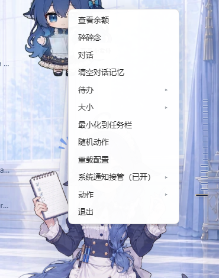
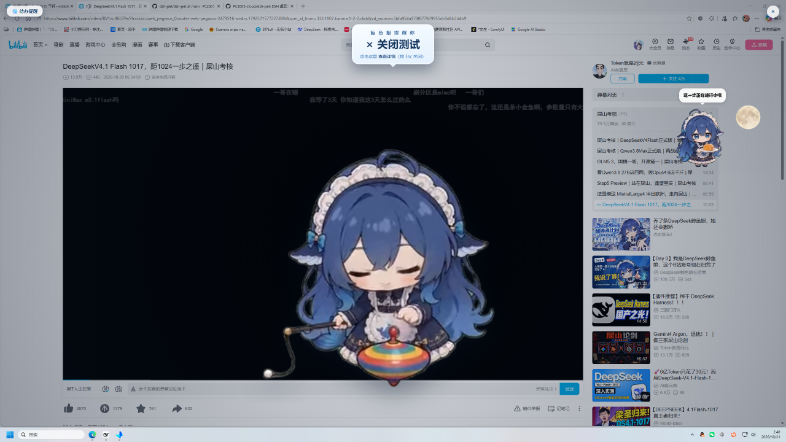
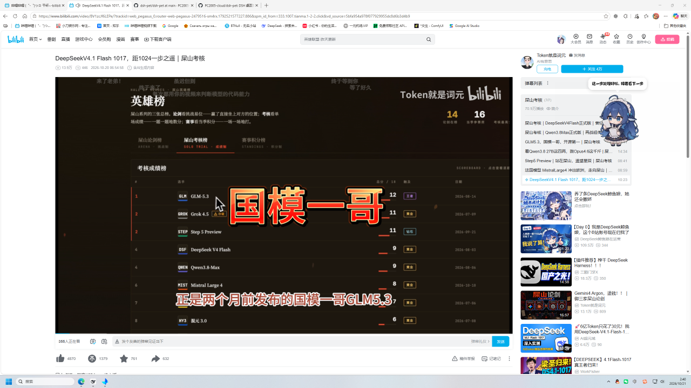
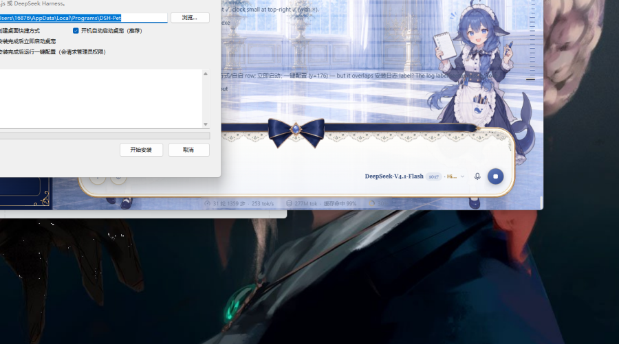

# 鲸鱼娘 · dsh-pet Windows 独立版

把开源桌面宠物 [dsh-pet](https://github.com/PC2005-cloud/dsh-pet)（DeepSeek Harness 的插件）做成了 **Windows 可独立安装的桌面软件**：不用装 DeepSeek Harness、不用装 Node.js，双击安装包就能在桌面上养一只蓝毛小女仆。

> 本项目是**非官方**的 Windows 打包/改造版，基于上游 MIT 项目二次开发，完全免费、**不做商用**。
> 素材（动画 / 表情包）版权归上游作者，按上游声明「允许开源使用，禁止商用」。






## 和原版有什么不一样

原版是 DSH 的插件：要先装 DSH，宠物住在 DSH 的界面/桌面上，余额、对话、碎碎念都依赖 DSH 的模型与会话。

这个版本把「宿主」整个搬到本地，并补了 Windows 用户日常会用到的一堆东西：

| 能力 | 原版（DSH 插件） | 本版本 |
| --- | --- | --- |
| 运行前提 | 需要安装并运行 DSH | **独立 exe，一个安装包装完即用** |
| 配置 | 与 DSH 共用 `~/.dsh/dsh-pet/` | **独立目录** `~/.dsh/dsh-pet-standalone/`（互不干扰） |
| AI 对话 / 碎碎念 | 用 DSH 的当前模型 | **自带 DeepSeek 兼容 API**（可在右键菜单里填 API Key），DSH 在线时优先走 DSH |
| 余额 | 依赖 DSH 的余额接口 | DSH 在线时镜像显示；**DSH 关闭时静默不提示**（不会弹"不支持查询"） |
| 开机自启 | 无 | 一键注册 / 取消 |
| 游戏全屏 | 无 | **全屏时自动隐藏，退出全屏自动回来** |
| 托盘 | 无 | **最小化到任务栏通知区**，托盘右键「恢复桌宠 / 退出桌宠」 |
| 大小 / 名字 | 改配置文件 | 右键菜单直接改（大小 小/标准/大/特大；名字改了之后所有自称都跟着变） |
| 整点报时 | 无 | **每半小时（:00 / :30）它自己变成一块鲸鱼娘风格时钟**，持续 60 秒，可自定义提示音 |
| 待办提醒 | 无 | 右键「待办」：不重复 / 每天 / 每周多选周几 / 每月多选几号；到点**整屏放大播「抽陀螺」动画 + 标题气泡**，点气泡看详情 |
| 系统通知 | DSH 自己弹 | **只静音 DSH 自身的系统弹窗**（退出即还原），其他 App 通知不受影响，DSH 的通知内容改由桌宠播报 |
| 安装包体积 | — | 精简到 **151 MB**（Electron 只留中英文语言包、移除 WebGPU/SwiftShader、payload 用 zstd 压缩），装完约 324 MB |

## 下载安装

1. 到本仓库右侧 **Releases** 页下载最新 `鲸鱼娘-安装程序.exe`（或 `DSH-Pet-Setup.exe`）。
2. 双击运行。若 Windows 提示「已保护你的电脑」→ 点「更多信息」→「仍要运行」（本项目**没有数字签名**，这是正常现象）。
3. 选择安装目录（默认 `%LOCALAPPDATA%\Programs\DSH-Pet`）→ 勾选「创建桌面快捷方式」「开机自动启动」「安装完成后运行桌宠」→ 开始安装。
4. 装完桌面会有「鲸鱼娘」快捷方式，右键它就有完整功能菜单。

也可以不用安装包，下载 `DSH-Pet-Windows-v16.zip` 解压后直接双击 `DSH-Pet.exe`（便携版，配置同样存在用户目录）。

## 使用提示

- **右键菜单**：查看余额 / 碎碎念 / 对话 / 清空对话记忆 / 待办 ▸ / 大小 ▸ / 最小化到任务栏 / 随机动作 / 重载配置 / 动作 ▸ / 改名… / API Key… / 退出
- **配置目录**：`%USERPROFILE%\.dsh\dsh-pet-standalone\`
  - `main-config.jsonc` 宠物配置（大小、位置、显示方式、记忆轮数等）
  - `ai-config.json` API Key / baseURL / 模型
  - `memory.json` 本地对话记忆（删掉即清空）
  - `todos.json` 待办列表
- **提示音目录**（安装目录下）：`sounds\chime\`（整点报时）、`sounds\notify\`（有新通知时）
- **全屏 / 托盘开关**：安装目录下 `guard.ini`
- 与 DSH 插件版**可以同时运行**，但会在桌面上出现两只，`guard.ini` 里 `hide_dsh_pet_always=1` 可以让本版本运行期间把 DSH 那只藏起来。

## 从源码构建

构建需要：Windows 10/11、.NET Framework 4.8 自带的 `csc.exe`、Node.js（仅用于跑补丁脚本）、Python + Pillow（生成图标）、以及一枚 [electron](https://github.com/electron/electron) 运行时目录。

```powershell
# 1) 准备：把 electron 解压到 runtime\electron（例如从 npm 的 electron 包或 GitHub Release）
# 2) 把上游 dsh-pet 的产物放进 app\（npm i dsh-pet 后的 package 内容）
# 3) 打补丁
node src\patch_v3.mjs  app
node src\patch_v4.mjs  app
node src\patch_v5.mjs  app
node src\patch_v6.mjs  app
node src\patch_v7.mjs  app
node src\patch_v8.mjs  app
node src\patch_v9.mjs  app
node src\patch_v10.mjs app
node src\patch_v11.mjs app
node src\patch_v12.mjs app
node src\patch_extras20.mjs app
node src\patch_extras21.mjs app
node src\patch_extras22.mjs app
node src\patch_sprite_extra.mjs app
# 4) 编译启动器 / 卸载器 / 安装器
#    见 src\build.ps1（完整 10 步流水线）
```

`src\build.ps1` 就是本项目的实际构建脚本（复制 Electron → 复制插件 → 打补丁 → 生成图标 → 编译 DSH-Pet.exe → 文档 → 自检 → 编译卸载器 → 生成 zstd payload → 编译安装器）。

## 许可与致谢

- **代码**：MIT（见 [LICENSE](LICENSE)）。上游 `dsh-pet` 版权归 **PC2005-cloud**，本项目在其基础上修改。
- **素材**（动画 / 表情包 / 提示词）：版权归上游作者，按上游 README 声明「**允许开源使用，禁止商用**」。
- 具体改动清单见 [NOTICE.md](NOTICE.md)。
- 上游项目：<https://github.com/PC2005-cloud/dsh-pet>
- 本项目**完全免费、不做商业用途**，与上游作者无隶属关系，不代表其认可。

## 免责声明

软件按「原样」提供，不附带任何担保。因使用本软件造成的任何直接或间接损失，作者不承担责任。
